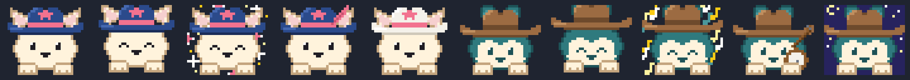

# howdy

**Claude Code 작업과 함께 자라는 카우보이모자 단짝.** Locki나 Cappl 중 하나를 고르면 됩니다. 둘은 프롬프트 위로 고개를 내밀고, Claude가 일하는 동안 앞발을 톡톡 두드리고, 테스트가 통과하거나 커밋이 들어가거나 PR이 병합되면 기뻐합니다. 결과마다 명성과 골드가 쌓입니다. 명성이 오르면 계급이 새내기에서 서부의 전설까지 오르고, 골드로는 모자·선글라스·밴조·배경을 삽니다.



[English README](README.md)

## 설치

howdy는 Claude Code mod(훅 모듈이 든 플러그인)이고 Claude Code 2.1.287 이상에서 돌아갑니다.

```
/plugin install howdy --marketplace <owner>/howdy
```

마켓플레이스를 추가할지 물으면 `y`를 누르고 범위는 user를 그대로 둡니다. 설치한 세션에는 창이 바로 뜹니다. 이미 열려 있던 세션에서는 `/reload-plugins`를 입력하세요. 셸에서는 `claude plugin install howdy --marketplace <owner>/howdy`로 설치합니다.

업데이트: `/plugin` → **Marketplaces** → `howdy` → **Enable auto-update**를 켜 두면 알아서 받습니다. 켜지 않았다면 `claude plugin update howdy@howdy`를 실행한 뒤 `/reload-plugins`를 입력합니다.

## 쓰는 법

| | |
|---|---|
| `/howdy` | 창 열기·닫기. Claude가 일하는 중에도 됩니다. 닫아 두면 다음 세션에도 닫힌 채로 시작합니다. |
| `/howdy-pick` | 함께할 친구 고르기. `/howdy-pick cappl`은 바로 바꾸고, 그냥 `/howdy-pick`은 창에 고르기 화면을 띄웁니다. |
| `/howdy-status` | 레벨·계급·명성·골드 한 줄 요약 |
| `/howdy-rules` | 보상표와 오늘 받은 횟수 |
| `/howdy-sound` | 효과음 크기: 보통 → 작게 → 끔 |

창을 클릭하거나 `ctrl+x` 다음 `Tab`으로 창에 포커스를 줍니다. 그다음 `1`~`0`은 소품을 사거나 쓰고 벗고, `c`는 캐릭터를 바꾸고, `q`는 창을 닫습니다. 110열 이상의 넓은 fullscreen 터미널에서는 창이 오른쪽에 붙고, 그 밖에는 프롬프트 위에 뜹니다. 창이 낮으면 작은 캐릭터 옆에 레벨과 명성을 두고, 상점은 아래로 내려 보라고 안내합니다.

여러 세션이 기록 하나를 함께 씁니다. 명성·골드·최근 보상·산 소품·고른 캐릭터는 2초 안에 열린 창 모두에 반영됩니다.

언어는 Claude Code의 `language` 설정(한국어·영어)을 따릅니다. 고정하려면 `/config`에서 **howdy › Language**를 바꿉니다.

## 두 친구

| | Locki | Cappl |
|---|---|---|
| 성격 | 보안관이 꿈인 씩씩한 친구. 모자의 분홍 별이 자랑이에요. | 넓은 갈색 모자를 쓴 떠돌이. 느긋하고 꾸준하며 늘 콧노래를 불러요. |
| 소리 | 사각파 칩튠, 하모니카, 짧게 튀는 소리, 박차 방울 | 밴조 튕기는 소리, 낮은 콧노래, 말발굽 |
| 축하할 때 | 분홍·금빛 별이 반짝이고 귀가 쫑긋 | 음표가 떠오르고 모자를 살짝 들어 올림 |
| 옷장 | 보안관 선글라스, 분홍 깃털, 하모니카, 하트 선글라스, 올가미 밧줄, 금빛 보안관 별, 한낮의 사막, 하얀 카우보이모자, 사막의 노을, 별밤 모자 | 동그란 안경, 밀짚 한 가닥, 양철 커피잔, 무법자 두건, 밴조, 참새 친구, 모닥불, 검은 카우보이모자, 별이 빛나는 밤, 황금 밴조 |

옷장은 캐릭터마다 따로 있고 골드는 함께 씁니다. 모든 소품은 큰 그림과 작은 그림 둘 다 있습니다([스프라이트 시트](docs/howdy-sheet.png)).

## 무엇에 보상하나

사람이 확인할 수 있는 결과에만 보상합니다. Claude가 얼마나 일했는지는 세지 않습니다. 프롬프트·턴·도구 호출·토큰·코드 줄 수에는 보상이 없습니다.

| 보상 | 언제 | 명성 | 골드 |
|---|---|---|---|
| 과녁 명중 | 파일을 고친 뒤 처음 통과한 테스트 | 5 | $3 |
| 결투 승리 | 테스트 실패 → 수정 → 통과 | 8 | $5 |
| 말뚝 박기 | 커밋(직전 커밋 뒤 테스트로 확인했으면 명성 +5·$3, 작은 커밋이면 명성 +2) | 3 | $2 |
| 금맥 발견 | `gh pr merge` 성공 | 15 | $10 |
| 지도 펼치기 | 고치기 전에 계획 승인 | 3 | $2 |
| 모닥불 휴식 | 한 시간 넘게 일하고 20분 이상 쉬고 돌아옴 | 2 | $4 |
| 안장 얹기 | 그날 첫 프롬프트 | 0 | $10 |

같은 날 같은 보상을 많이 받으면 값이 절반, 다시 5분의 1로 줄어듭니다. 연속 출석 기록이나 벌칙은 없고, 하루 쉬어도 잃는 것이 없습니다. 하루는 이 컴퓨터 시계로 새벽 5시에 바뀝니다. 꾸준히 쓰면 레벨 50까지 활동 시간으로 약 1,000시간이 걸립니다. 수치와 근거는 [docs/reward-design.md](docs/reward-design.md)에 있습니다.

## 개인정보

서버와 네트워크 호출이 없고 파일도 읽지 않습니다. `claude plugin validate ./mod` 결과에 `$.http`와 `$.fs`가 없습니다. 외부 프로세스는 효과음을 틀 때만 씁니다(`uname`, `wslpath`, `powershell.exe`, `paplay`, `pw-play`, `aplay`). 읽는 설정은 `language` 하나입니다. 진행 기록은 내 컴퓨터의 `~/.claude/plugins/store/howdy_*.json`에만 남고, 순위표는 없습니다.

## 내 기록으로 속도 재기

레벨 곡선은 한 사람의 Claude Code 기록 27일치(활동 185시간)로 맞췄습니다. 내 속도를 보려면:

```sh
python3 -I tools/extract_events.py ~/.claude/projects .data/events.jsonl
bun tools/sim.ts .data/events.jsonl
```

프롬프트와 코드는 남기지 않습니다. 테스트·커밋·병합 명령만 명령문과 출력 앞뒤 일부를 `.data/`(git 제외)에 남깁니다. 속도를 바꾸려면 `mod/hooks/rules.ts`의 `LEVEL_BASE`를 고칩니다.

## 개발

명령과 폴더 구성은 [영문 README](README.md#develop)에 있습니다. 캐릭터를 더하는 방법은 [docs/characters.md](docs/characters.md)를 보세요.

## 라이선스

코드는 [MIT 라이선스](LICENSE)입니다. Locki와 Cappl의 캐릭터 디자인과 픽셀 그림은 [ART-LICENSE.md](ART-LICENSE.md)를 따릅니다.
