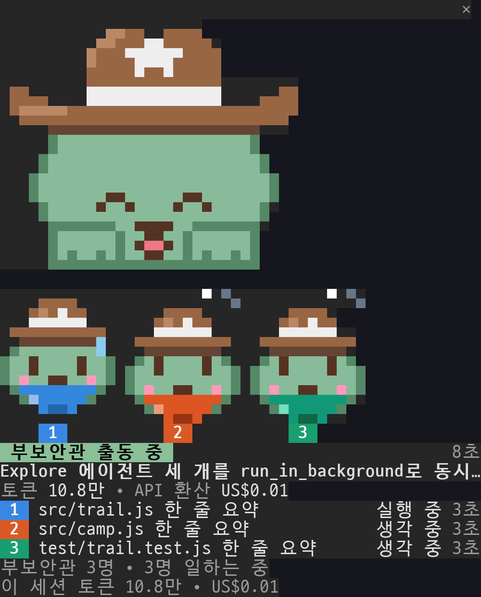

# cappl-pals

**[Sundust](#sundust-세계관) 세계관의 카우보이모자 친구 RIKI, CARO, NUMO가 Claude Code 작업과 함께 자랍니다.** 셋 중 하나를 고르면 됩니다. 친구들은 프롬프트 위로 고개를 내밀고 세션 상태에 따라 모습이 바뀝니다. Claude가 생각할 때는 말풍선을 띄우고, 파일을 고칠 때는 혀를 내밀고, 테스트를 돌릴 때는 식은땀을 흘리고, 자리를 비우면 낮잠을 잡니다. 테스트가 통과하거나 커밋이 들어가거나 PR이 병합되면 기뻐합니다. Claude가 띄우는 하위 에이전트는 자기 색 반다나를 두른 부보안관이 되고, 창에는 요청의 계획·부보안관·시간·토큰·비용이 나옵니다. 쓰다듬거나 재주를 부탁하거나 간식을 사 줄 수도 있습니다. 결과마다 명성과 골드가 쌓이고, 레벨 상자·오늘의 현상금·행운의 사금으로 골드가 더 들어옵니다. 명성이 오르면 계급이 새내기에서 서부의 전설까지 오르고 새 재주를 배웁니다. 골드로는 모자·선글라스·밴조·배경을 삽니다.

[](docs/cappl-pals-demo.ko.mp4)

▶ 소리까지 있는 전체 데모(1분 30초): [한국어](docs/cappl-pals-demo.ko.mp4) · [English](docs/cappl-pals-demo.mp4)

**웹사이트:** [develinu.github.io/cappl-pals](https://develinu.github.io/cappl-pals/?lang=ko). 브라우저에서 친구를 쓰다듬고, 옷장을 입혀 보고, Lv50까지의 여정을 미리 볼 수 있습니다.

창·알림·명령은 영어와 한국어를 모두 지원합니다.


[English README](README.md)

## 설치

cappl-pals는 Claude Code mod(훅 모듈이 든 플러그인)이고 Claude Code 2.1.287 이상에서 돌아갑니다.

```
/plugin install cappl-pals --marketplace develinu/cappl-pals
```

마켓플레이스를 추가할지 물으면 `y`를 누르고 범위는 user를 그대로 둡니다. 설치한 세션에는 창이 바로 뜹니다. 이미 열려 있던 세션에서는 `/reload-plugins`를 입력하세요. 셸에서는 `claude plugin install cappl-pals --marketplace develinu/cappl-pals`로 설치합니다.

데스크톱 앱에서는 `/plugin`이 동작하지 않습니다. 프롬프트 옆 **+** → **플러그인 추가** → **+ 추가** → **마켓플레이스 추가** → **저장소에서 추가**를 고르고, 저장소 주소 `develinu/cappl-pals`를 넣은 뒤 **동기화**를 누릅니다. 그다음 목록에 나오는 cappl-pals를 추가합니다. 같은 컴퓨터의 터미널에서 user 범위로 설치했다면 데스크톱 앱의 로컬 세션에도 켜집니다. 단, WSL의 Claude Code는 설정을 따로 쓰므로 Windows 데스크톱 앱에는 한 번 더 설치해야 하고 진행 기록도 따로 쌓입니다.

cappl-pals는 내 컴퓨터에서 도는 Claude Code라면 어디서든 동작합니다. 터미널과 데스크톱 앱의 Code 탭에서 쓸 수 있고, 데스크톱에서는 움직이는 그림과 누를 수 있는 버튼으로 창이 뜹니다. 웹의 Claude Code처럼 클라우드에서 도는 세션은 내 컴퓨터의 플러그인을 불러오지 않아 동작하지 않습니다.

### 자동 업데이트 켜기(권장)

직접 추가한 마켓플레이스는 자동 업데이트가 꺼져 있습니다. 한 번만 켜 두면 새 버전이 나올 때마다 알아서 받습니다.

- Claude Code에서: `/plugin` → **Marketplaces** → `cappl-pals` → **Enable auto-update**
- 또는 `~/.claude/settings.json`의 마켓플레이스 항목에 `autoUpdate`를 넣습니다.

```json
"extraKnownMarketplaces": {
  "cappl-pals": {
    "source": { "source": "github", "repo": "develinu/cappl-pals" },
    "autoUpdate": true
  }
}
```

세션에서 첫 메시지를 보낸 뒤 10분 안에 백그라운드에서 새 버전을 받습니다. 이미 열려 있던 세션은 이전 버전을 계속 씁니다. 대신 `Plugin updated: cappl-pals · Run /reload-plugins to apply`가 뜹니다. 그 세션에서 `/reload-plugins`를 입력하거나 새 세션을 열면 새 버전이 켜집니다.

자동 업데이트를 켜지 않았다면 `claude plugin update cappl-pals@cappl-pals`로 직접 받습니다. 그다음 `/reload-plugins`를 입력합니다. 지우려면 `claude plugin uninstall cappl-pals@cappl-pals`입니다.

## 쓰는 법

| | |
|---|---|
| `/cappl` | 창 열기·닫기. Claude가 일하는 중에도 됩니다. 닫아 두면 다음 세션에도 닫힌 채로 시작합니다. |
| `/cappl-pick` | 함께할 친구 고르기. `/cappl-pick caro`는 바로 바꾸고, 그냥 `/cappl-pick`은 창에 고르기 화면을 띄웁니다. |
| `/cappl-status` | 레벨·계급·명성·골드 한 줄 요약 |
| `/cappl-rules` | 보상표와 오늘 받은 횟수 |
| `/cappl-sound` | 효과음 크기: 보통 → 작게 → 끔 |

창의 조작은 모두 한 줄에 하나씩 있는 버튼입니다. 쓰다듬기·재주·간식, 상점(소품 사기, 쓰고 벗기), 규칙과 현상금 설명, 내 현황(오늘 받은 보상·재주·옷장), 캐릭터 바꾸기, 창 닫기가 있습니다. 마우스로 누르거나 키보드로 조작합니다. `ctrl+x` 다음 `Tab`으로 창에 키보드를 주고, `Tab`과 화살표 키로 버튼 사이를 옮기고(창보다 내용이 길면 화살표는 스크롤), `Enter`로 누릅니다. `Esc`를 누르면 키보드가 프롬프트로 돌아갑니다. 지금 무엇이 되는지는 창 안의 안내 줄에 나옵니다. 110열 이상의 넓은 fullscreen 터미널에서는 창이 오른쪽에 붙고, 그 밖에는 프롬프트 위에 뜹니다. 창이 낮으면 작은 캐릭터 옆에 레벨과 명성을 둡니다.

여러 세션이 기록 하나를 함께 씁니다. 명성·골드·최근 보상·산 소품·고른 캐릭터는 2초 안에 열린 창 모두에 반영됩니다.

언어는 Claude Code의 `language` 설정(한국어·영어)을 따릅니다. 고정하려면 `/config`에서 **cappl-pals › Language**를 바꿉니다.

## 기분과 놀이

친구의 모습은 세션이 하는 일에 따라 바뀝니다.

| 세션 | 친구 |
|---|---|
| 프롬프트를 보냄 | `!`를 띄우며 귀를 쫑긋 |
| Claude가 생각하는 중 | 턱에 앞발을 괴고 `…` 말풍선 |
| 파일 읽기·검색 | 눈으로 페이지를 훑어 내려감 |
| 파일 수정 | 혀를 내밀고 앞발을 톡톡 |
| 명령 실행 | 좌우로 흔들흔들 |
| 테스트 실행 | 눈이 동그래지고 식은땀 한 방울 |
| 테스트 실패 | 눈이 X자로 어질어질, 곧 다시 힘을 냄 |
| 권한 확인 대기 | `?` 말풍선을 띄우고 손을 흔듦 |
| 턴이 끝남 | 짧은 춤 |
| 5분 동안 아무 일 없음 | `z z z` 낮잠 |
| 그 밖의 시간 | 눈을 깜빡이고, 두리번거리고, 기지개를 켜고, 하품하고, 콧노래를 부르고, 배운 재주를 부림 |

| 버튼 | 비용 | 하는 일 |
|---|---|---|
| 쓰다듬기 | 무료 | 하트 눈과 하트가 퐁퐁. 빠르게 세 번 쓰다듬으면 몸을 흔들며 좋아함 |
| 재주 | 무료 | 가장 최근에 배운 재주부터 차례로 보여 줌. Lv2 손 흔들기부터 Lv50까지 열 가지를 배움 |
| 간식 | $6 | RIKI는 별 쿠키, CARO는 메이플 비스킷, NUMO는 이슬 한 방울을 먹음. 그 뒤 10분 동안 볼이 발그레하고 재주를 두 배로 자주 부림 |

쓰다듬기와 재주로는 명성을 받지 않습니다. 데스크톱 앱에서도 같은 동작을 하고, 마우스를 올리면 손을 흔듭니다.

## 작업과 부보안관

Claude가 일하는 동안 창에 이 세션이 무엇을 하는지, 얼마나 드는지 나옵니다.




| | |
|---|---|
| 요청 | 친구가 지금 하는 일(생각 중·읽는 중·고치는 중·실행 중·테스트 중·허락 기다림)을 표시로 보여 주고, 옆에 프롬프트를 보낸 뒤 지난 시간, 아래에 프롬프트 첫 줄을 둡니다. 답이 나오면 끝남·멈춤·오류로 바뀝니다. |
| 계획 | Claude가 할 일 목록(TaskCreate·TaskUpdate 또는 TodoWrite)을 쓰면 몇 단계를 끝냈는지와 지금 하는 단계를 막대로 보여 줍니다. |
| 부보안관 | Claude가 띄우는 하위 에이전트 하나하나가 보안관을 돕는 부보안관입니다. 자기 색 반다나를 두른 작은 RIKI·CARO·NUMO가 번호를 달고 나옵니다. 반짝이며 도착해서 보안관처럼 읽고, 두드리고, 땀을 흘립니다. 일을 마치면 기뻐하고, 실패하면 어지러워하고, 멈추면 잠듭니다. 아래에는 부보안관마다 한 줄로 맡은 일, 지금 하는 일, 걸린 시간, 넓은 창에서는 토큰까지 나옵니다. 보안관이 부보안관을 기다리는 동안에는 표시가 "부보안관 출동 중"으로 바뀝니다. 부보안관은 창 크기와 상관없이 모두 번호 순서대로 그리고, 좁은 창에서는 줄을 바꿔 이어 그립니다. 색은 여섯 가지이고, 한 번에 일곱 번째부터는 그림 없이 숫자로만 세며, 그 뒤에 오는 부보안관은 가장 먼저 끝난 부보안관의 색을 이어받습니다. |
| 비용 | 요청에 쓴 토큰(부보안관 것 포함)과 요청이 도는 동안 늘어난 세션 비용을 `/cost`와 같은 기준으로 보여 줍니다. 구독으로 쓰면 청구액이 아니라 API로 환산한 값입니다. 그 아래에 이 세션의 토큰·비용과 5시간 한도가 나오고, 주간 한도는 넓은 창이거나 절반을 넘겼을 때 함께 나옵니다. 절반을 넘기면 초기화까지 남은 시간도 나옵니다. |

창이 넓으면 부보안관이 친구 옆에 나란히 서고, 오른쪽 도크에서는 친구 아래에 줄을 섭니다. 창이 낮으면 작은 친구 옆에 상태를 두고, 부보안관이 모두 들어갈 자리가 있으면 그 옆에, 아니면 그 아래에 섭니다. 일하는 동안에는 이 내용이 친구 바로 아래에 있다가, 끝나면 레벨·명성 아래로 내려갑니다. 작업은 창마다 자기 세션 것만 보여 주고, 친구·명성·골드는 모든 세션이 함께 씁니다. 부보안관에게는 명성도 골드도 주지 않습니다. 보상은 결과에만 주므로 하위 에이전트를 많이 띄운다고 더 받지 않습니다.

## 세 친구

| | RIKI | CARO | NUMO |
|---|---|---|---|
| 성격 | 사막여우 · 마을의 마음을 잇는 순찰 보안관. 처음 만난 주민에게도 먼저 인사하는 분위기 메이커예요. 표정과 말투의 작은 변화를 빨리 알아차리고, 직접 보고 움직이며 배워요. 재미있는 일엔 즉흥적으로 뛰어들어 작은 소동을 만들기도 해요. 친구가 풀이 죽으면 설명보다 먼저 곁에 앉아줘요. | 고양이 · 새로운 길을 여는 현장 보안관. 궁금한 사건엔 질문부터 쏟아내는 호기심 대장이에요. 익숙한 규칙보다 새 해결 방법을 좋아하고, 재치 있는 농담과 엉뚱한 제안으로 친구들의 생각을 깨워요. 위기엔 대담하지만 가끔 계획보다 발이 먼저 나가요. 친구의 아이디어와 합쳐질 때 더 신나요. | 선인장 · 돌아올 자리를 지키는 기록 보안관. 작은 약속도 오래 기억하고 묵묵히 지켜요. 주민의 습관이 달라진 것을 세심하게 알아차리고, 사건 일지를 차곡차곡 정리할 때 마음이 편해져요. 자기 어려움은 뒤로 미루기 쉬워 친구들의 돌봄도 필요해요. 좋아하는 마음은 큰 말보다 미리 준비한 작은 행동으로 전해요. |
| 한마디 | “좋아, 같이 가면 더 재밌겠네!” | “잠깐, 꼭 그 방법이어야 해?” | “천천히 와. 네 자리도 준비해뒀어.” |
| 재주 | 귀로 그리는 소리 지도. 바람과 발소리를 머릿속 지도로 그려요. 소리가 너무 겹치면 지도가 뒤섞여요. | 수염 나침반·골골 진동. 새 단서 쪽으로 수염이 떨리고, 골골 소리로 친구들의 긴장을 풀어요. 생각이 너무 많으면 수염이 제각각 가리켜요. | 볼에 피는 마음꽃. 편안한 날이 이어지면 볼 옆에 크림색 꽃이 피어요. 억지로 피울 수 없고, 쉬지 못한 날엔 봉오리를 닫아요. |
| 소리 | 사각파 칩튠, 하모니카, 짧게 튀는 소리, 박차 방울 | 밴조 튕기는 소리, 낮은 콧노래, 말발굽 | 지금은 CARO의 소리를 함께 씀. 전용 소리는 준비 중 |
| 축하할 때 | 분홍·금빛 별이 반짝이고 귀가 쫑긋 | 음표가 떠오르고 모자를 살짝 들어 올림 | 세이지·크림빛 별이 반짝임 |
| 옷장 | 보안관 선글라스, 분홍 깃털, 하모니카, 하트 선글라스, 올가미 밧줄, 금빛 보안관 별, 한낮의 사막, 하얀 카우보이모자, 사막의 노을, 별밤 모자 | 동그란 안경, 밀짚 한 가닥, 양철 커피잔, 무법자 두건, 밴조, 참새 친구, 모닥불, 검은 카우보이모자, 별이 빛나는 밤, 황금 밴조 | 독서 안경, 선인장 꽃, 물뿌리개, 태양 고글, 기록 수첩, 달 배지, 한낮의 오아시스, 카멜색 모자, 별빛 오아시스, 황금 물뿌리개 |

옷장은 캐릭터마다 따로 있고 골드는 함께 씁니다. 모든 소품은 큰 그림과 작은 그림 둘 다 있습니다([스프라이트 시트](docs/cappl-pals-sheet.png)).

## Sundust 세계관

RIKI, CARO, NUMO는 세 앱이 함께 쓰는 세계관 **Sundust(선더스트)**의 캐릭터입니다. 선더스트는 먼 서부의 작은 오아시스 마을입니다. 낮에는 모래바람이 길을 바꾸고, 밤에는 별빛이 오래된 길을 드러냅니다. 이곳의 보안관은 누군가를 쫓기보다 잃어버린 물건, 길을 잃은 주민, 어긋난 하루를 제자리로 돌려놓습니다. 사건 일지의 마지막 줄은 늘 “모두 무사히 귀가”입니다. 친구마다 대표하는 앱이 있습니다. CARO는 계획·회고 앱 **CAPPL**, RIKI는 화면 잠금 앱 **LOCKI**, NUMO는 아직 출시 전인 앱 **TUSMO**의 얼굴입니다.

CAPPL은 내 계획 스타일과 실행 방식, 하루 에너지 흐름을 살펴 나에게 맞는 일정 관리 템플릿을 추천해 줍니다. cappl-pals가 끝낸 일을 함께 기뻐해 준다면, CAPPL은 그 일을 계획하고 돌아보게 도와줍니다.

[App Store](https://apps.apple.com/kr/app/cappl/id6761328898)나 [Google Play](https://play.google.com/store/apps/details?id=com.ksh.cappl&hl=ko)에서 받을 수 있습니다. 이 프로젝트에서는 각 앱의 허가를 받아 캐릭터를 사용합니다.

## 무엇에 보상하나

사람이 확인할 수 있는 결과에만 보상합니다. Claude가 얼마나 일했는지는 세지 않습니다. 프롬프트·턴·도구 호출·토큰·코드 줄 수에는 보상이 없습니다.

| 보상 | 언제 | 명성 | 골드 |
|---|---|---|---|
| 과녁 명중 | 파일을 고친 뒤 처음 통과한 테스트 | 5 | $3 |
| 결투 승리 | 테스트 실패 → 수정 → 통과 | 8 | $5 |
| 말뚝 박기 | 커밋(직전 커밋 뒤 테스트로 확인했으면 명성 +5·$3, 작은 커밋이면 명성 +2) | 3 | $2 |
| 깔끔한 사격 | 파일을 고친 뒤 오류 없이 끝난 타입 검사·린트·빌드 | 2 | $2 |
| 전단 붙이기 | `gh pr create`로 PR을 엶 | 4 | $3 |
| 금맥 발견 | `gh pr merge` 성공 | 15 | $10 |
| 지도 펼치기 | 고치기 전에 계획 승인 | 3 | $2 |
| 모닥불 휴식 | 한 시간 넘게 일하고 20분 이상 쉬고 돌아옴 | 2 | $4 |
| 안장 얹기 | 그날 첫 프롬프트 | 0 | $10 |

골드는 이런 데서도 들어옵니다.

| 보너스 | 언제 | 골드 |
|---|---|---|
| 레벨 상자 | 레벨이 오를 때마다 | $5 + 레벨 |
| 현상금 | 창에 하루 세 개: 친구와 하는 일 하나, 작업 결과 둘 | 하나에 $5~$15, 셋 다 끝내면 $15 더 |
| 행운의 사금 | 결과 열여섯 번에 한 번꼴 | $5~$15 |

같은 날 같은 보상을 많이 받으면 값이 절반, 다시 5분의 1로 줄어듭니다. 연속 출석 기록이나 벌칙은 없고, 하루 쉬어도 잃는 것이 없습니다. 하루는 이 컴퓨터 시계로 새벽 5시에 바뀝니다. 꾸준히 쓰면 레벨 50까지 활동 시간으로 약 830시간이 걸립니다. 수치와 근거는 [docs/reward-design.md](docs/reward-design.md)에 있습니다.

## 개인정보

서버와 네트워크 호출이 없고 파일도 읽지 않습니다. `claude plugin validate ./mod` 결과에 `$.http`와 `$.fs`가 없습니다. 외부 프로세스는 효과음을 틀 때만 씁니다(`uname`, `wslpath`, `powershell.exe`, `paplay`, `pw-play`, `aplay`). 읽는 설정은 `language` 하나이고, 세션에서는 비용·사용 한도·하위 에이전트 목록을 읽어 그 세션의 메모리에만 둡니다. 진행 기록은 내 컴퓨터의 `~/.claude/plugins/store/cappl-pals_*.json`에만 남고, 순위표는 없습니다.

## 내 기록으로 속도 재기

레벨 곡선은 한 사람의 Claude Code 기록 28일치(활동 189시간)로 맞췄습니다. 내 속도를 보려면:

```sh
python3 -I tools/extract_events.py ~/.claude/projects .data/events.jsonl
bun tools/sim.ts .data/events.jsonl
```

프롬프트와 코드는 남기지 않습니다. 테스트·검사·커밋·PR·병합 명령만 명령문과 출력 앞뒤 일부를 `.data/`(git 제외)에 남깁니다. 속도를 바꾸려면 `mod/hooks/rules.ts`의 `LEVEL_BASE`를 고칩니다.

## 개발

명령과 폴더 구성은 [영문 README](README.md#develop)에 있습니다. 캐릭터를 더하는 방법은 [docs/characters.md](docs/characters.md)를 보세요.

## 라이선스

코드는 [MIT 라이선스](LICENSE)입니다. RIKI·CARO·NUMO 캐릭터와 그림은 cappl-pals와 그 포크 안에서만 쓸 수 있고, 그 밖의 용도는 각 캐릭터의 앱(CAPPL·LOCKI·TUSMO)의 허락이 필요합니다. 자세한 내용은 [ART-LICENSE.md](ART-LICENSE.md)에 있습니다.
