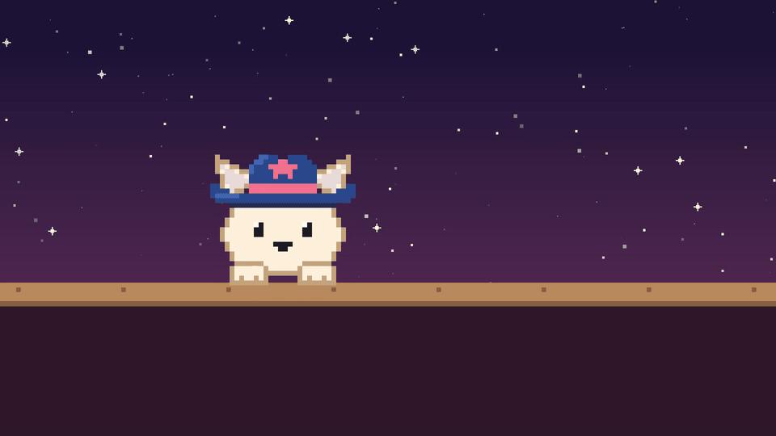
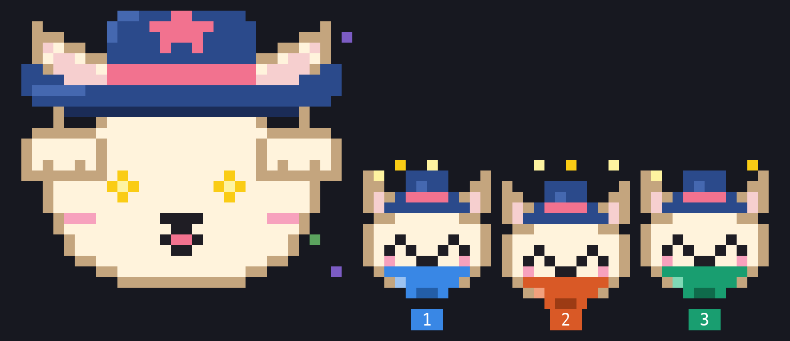
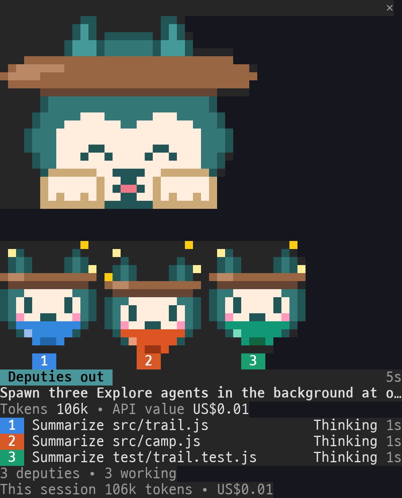

# cappl-pals

**RIKI, CARO and NUMO, cowboy-hat pals from the [Sundust](#the-sundust-world) world, grow with your Claude Code work.** Pick one. They peek over your prompt and follow your session: a thought bubble while Claude thinks, a busy tongue while it edits, a nervous sweat while tests run, a nap when you step away. They cheer when a test passes, a commit lands or a pull request merges. Every subagent Claude sends off becomes one of their deputies, in a bandana of its own colour, and the pane follows the request: its plan, its deputies, its time, tokens and cost. Pet them, ask for a trick, or buy them a treat. Results earn rep and gold, and level chests, daily bounties and lucky nuggets add more gold. Rep raises your rank from Greenhorn to Legend of the West and teaches new tricks; gold buys hats, shades, banjos and backdrops.

[](docs/cappl-pals-demo.mp4)

▶ Full demo with sound (1 min 40 s): [English](docs/cappl-pals-demo.mp4) · [한국어](docs/cappl-pals-demo.ko.mp4)

**Website:** [develinu.github.io/cappl-pals](https://develinu.github.io/cappl-pals/). Pet the pals, try on the wardrobe and walk the trail to Lv50 in your browser.

The pane, toasts and commands speak English and Korean.


[한국어 README](README.ko.md)

## Install

cappl-pals is a Claude Code mod (a plugin with a hooks module). It needs Claude Code 2.1.287 or later.

```
/plugin install cappl-pals --marketplace develinu/cappl-pals
```

Answer `y` to add the marketplace and keep the user scope. The pane opens in the session where you install it. For sessions that were already open, run `/reload-plugins`. To install from a shell, run `claude plugin install cappl-pals --marketplace develinu/cappl-pals`.

In the desktop app, where `/plugin` doesn't run: click **+** next to the prompt, choose to add plugins, press **+** to add a marketplace, pick adding it from a repository, enter `develinu/cappl-pals` and sync, then add cappl-pals from the plugin list that appears. A plugin installed from a terminal at the user scope also loads in the desktop app's local sessions on the same computer. (Claude Code in WSL keeps its own settings, so a Windows desktop app needs its own install, and keeps its own progress.)

cappl-pals runs wherever Claude Code runs on your computer: the terminal and the desktop app's Code tab, where the pane shows the pals as an animated picture with clickable buttons. Sessions in the cloud, such as Claude Code on the web, don't load plugins from your computer, so it doesn't run there.

### Turn on auto-update (recommended)

Marketplaces you add yourself don't update on their own. Turn it on once and every new version arrives by itself:

- In Claude Code: `/plugin` → **Marketplaces** → `cappl-pals` → **Enable auto-update**
- Or in `~/.claude/settings.json`, set `autoUpdate` on the marketplace entry:

```json
"extraKnownMarketplaces": {
  "cappl-pals": {
    "source": { "source": "github", "repo": "develinu/cappl-pals" },
    "autoUpdate": true
  }
}
```

A new version downloads in the background within about ten minutes of the first message in a session. Sessions that are already open keep the old version and show `Plugin updated: cappl-pals · Run /reload-plugins to apply`; run `/reload-plugins` there, or start a new session.

Without auto-update, update by hand with `claude plugin update cappl-pals@cappl-pals`, then `/reload-plugins`. To remove it: `claude plugin uninstall cappl-pals@cappl-pals`.

## Use

| | |
|---|---|
| `/cappl` | Open or close the pane. It works mid-turn. A closed pane stays closed in later sessions. |
| `/cappl-pick` | Choose your partner. `/cappl-pick caro` switches right away; `/cappl-pick` alone opens the picker. |
| `/cappl-status` | Level, rank, rep and gold in one line. |
| `/cappl-rules` | The reward table and how many of each you earned today. |
| `/cappl-sound` | Cycle the sound: normal → quiet → off. |

Every control in the pane is a button on its own row: pet, trick and treat, the shop (buy an item, or put it on and take it off), the rules and what each bounty means, your progress (today's rewards, tricks and wardrobe), switching characters, and closing. Click one, or drive the pane from the keyboard: `ctrl+x` then `Tab` gives it the keyboard, `Tab` and the arrow keys move between the buttons (the arrows scroll a pane taller than its window), `Enter` presses the one in focus, and `Esc` hands the keyboard back to the prompt. A hint line in the pane says which applies. On a wide fullscreen terminal (110 columns or more) the pane docks on the right. On other terminals it opens above the prompt. A low pane shows the small sprite with your stats beside it.

Several sessions share one profile. Rep, gold, recent rewards, purchases and your choice of character show up in every open pane within about two seconds.

The language follows Claude Code's `language` setting (Korean or English). To pin it, open `/config` and change **cappl-pals › Language**.

## Moods and play

The pal changes with what the session is doing.

| Session | The pal |
|---|---|
| You send a prompt | Perks up with a `!` |
| Claude is thinking | Paw on chin, a `…` bubble |
| Reading or searching | Eyes scanning down the page |
| Editing files | Tongue out, paws tapping |
| Running a command | Swaying side to side |
| Running tests | Wide eyes, a drop of sweat |
| A test fails | Dizzy eyes, then a determined frown |
| Waiting for your permission | A `?` bubble and a wave |
| A turn ends | A little dance |
| Five minutes with nothing going on | Falls asleep, `z z z` |
| Nothing else going on | Blinks, looks around, stretches, yawns, hums and shows off tricks |

| Button | Cost | What happens |
|---|---|---|
| Pet | Free | Heart eyes and hearts. Pet three times quickly for a happy wiggle. |
| Trick | Free | Your pal's newest trick, then the others in turn. Each pal learns ten, from a wave at Lv2 to a big finale at Lv50. |
| Treat | $6 | RIKI eats a star cookie, CARO a maple biscuit, NUMO a dew drop. Then they blush for 10 minutes and show off tricks twice as often. |

Petting and tricks never earn rep. On the desktop app the pal plays the same moves, and waves when you hover over it.

## Work and the deputies

While Claude works, the pane shows what your session is doing and what it costs.





| | |
|---|---|
| The request | A chip says what the pal is doing (Thinking, Reading, Editing, Running, Testing, Needs you), beside the time since you sent the prompt, with its first line under it. When the answer is in, it says Done, Stopped or Error. |
| The plan | When Claude keeps a task list (TaskCreate and TaskUpdate, or TodoWrite), a bar shows how many steps are done and the one in hand. |
| The deputies | Every subagent Claude sends off is one of your sheriff's deputies: a little RIKI, CARO or NUMO in a bandana of its own colour, with its number. Deputies arrive with sparkles, then read, tap away and sweat as their sheriff does. They cheer when they finish, look dizzy when they fail and doze off when stopped. One line per deputy gives its task, what it is doing, its time and, on a wide pane, its tokens. While the sheriff waits on them, the chip says Deputies out. Every deputy is drawn, in number order, wrapping to more rows on a narrow pane. There are six colours; a seventh deputy at once is counted, not drawn, and later ones take the colour of the first to finish. |
| What it cost | The request's tokens (its deputies' included) and what the session's cost grew by while it ran, as `/cost` counts it. On a subscription that is the API value, not a bill. Under it, this session's tokens and cost, and your 5-hour limit, with the weekly one on a wide pane or once half of it is used; once half is used, when it resets. |

On a wide pane the deputies stand beside the pal. In a dock they line up under it. A low pane keeps the status beside the small pal, and the deputies too when they all fit there. While work runs it sits right under the pal; once it is done it moves below your stats. Each pane shows its own session's work, while the pal, rep and gold are shared. Deputies earn no rep or gold: rewards stay on results, so sending off more helpers pays nothing.

## The pals

| | RIKI | CARO | NUMO |
|---|---|---|---|
| Who | A desert fox, the patrol sheriff who links the town's hearts. Greets newcomers first, catches small changes in a face or a voice, learns by seeing and doing, and sometimes jumps into fun and stirs up a little fuss. When a friend is down, sits beside them before saying anything. | A cat, the field sheriff who finds new paths. Meets a case with a stream of questions, prefers a new way to a familiar rule, wakes friends' thinking with jokes and odd ideas, and moves boldly in a pinch, sometimes feet before plan. Happiest when an idea joins up with a friend's. | A cactus, the record-keeping sheriff who keeps a place to come back to. Remembers small promises and keeps them quietly, notices when someone's habits change, and feels calm putting the case log in order. Tends to put their own troubles last, and shows care through small things prepared ahead rather than big words. |
| Says | "Let's go together — it's more fun that way!" | "Wait — does it have to be that way?" | "Take your time. Your spot is ready." |
| Gift | A sound map: big ears turn wind and footsteps into a map. Too much noise at once tangles it. | Whisker compass: whiskers twitch toward a new clue, and a purr calms friends. Too many thoughts at once send the whiskers every which way. | A heart flower: on calm, happy days a cream flower blooms by the cheek. It can't be forced, and closes on days without rest. |
| Sound | Square-wave chiptune, a harmonica, quick chirps, jingling spurs | Plucked banjo, a soft hum, hoof clops | CARO's sounds for now; a voice of its own is to come |
| Celebrates with | Twinkling pink and gold stars, ears perked | Music notes floating up, a tip of the hat | Twinkling sage and cream stars |
| Wardrobe | Aviator shades, pink feather, harmonica, heart shades, lasso, gold sheriff star, desert noon, white ten-gallon hat, desert sunset, starry night hat | Round specs, wheat straw, tin cup of coffee, outlaw bandana, banjo, sparrow friend, campfire, black hat, starry night, golden banjo | Reading specs, cactus bloom, watering can, sun goggles, logbook, moon badge, oasis noon, camel hat, starry oasis, golden watering can |

Each character keeps their own wardrobe; gold is shared. Every item has art at both sprite sizes ([sprite sheet](docs/cappl-pals-sheet.png)).

## The Sundust world

RIKI, CARO and NUMO are characters of **Sundust**, a world shared by three apps. Sundust is a small oasis town in the far West, where the sandy wind redraws the roads by day and starlight shows the old ones at night. Its sheriffs don't chase anyone; they bring lost things, lost residents and days gone astray back where they belong, and every entry in their case log ends with everyone home safe. Each pal is the face of one: CARO of **CAPPL**, a planning app; RIKI of **LOCKI**, a screen lock app; and NUMO of **TUSMO**, which is not out yet.

CAPPL looks at how you like to plan, how you get things done and how your energy runs through the day, then suggests a schedule template that fits you. cappl-pals cheers for the work you finish; CAPPL helps you plan it and look back on it.

Get CAPPL on the [App Store](https://apps.apple.com/app/id6761328898) or [Google Play](https://play.google.com/store/apps/details?id=com.ksh.cappl). The characters appear here with the apps' permission.

## What earns rewards

Rewards go to results a person can check, never to how much Claude did. Prompts, turns, tool calls, tokens and lines of code earn nothing.

| Reward | When | Rep | Gold |
|---|---|---|---|
| Bullseye | The first passing test after you edit files | 5 | $3 |
| Showdown won | A test fails, you fix it, it passes | 8 | $5 |
| Claim staked | A commit (+5 rep and $3 more if tests passed since the last one, +2 rep if it is small) | 3 | $2 |
| Clean shot | A type check, lint or build with no errors after you edit files | 2 | $2 |
| Poster up | `gh pr create` opens a pull request | 4 | $3 |
| Gold strike | `gh pr merge` succeeds | 15 | $10 |
| Trail mapped | A plan approved before editing | 3 | $2 |
| Campfire rest | Back from a 20-minute-plus break after an hour of work | 2 | $4 |
| Saddled up | Your first prompt of the day | 0 | $10 |

Gold also comes from:

| Bonus | When | Gold |
|---|---|---|
| Level chest | Every level you reach | $5 + the level |
| Bounties | Three a day in the pane: one with your pal, two from your work | $5–$15 each, $15 more for all three |
| Lucky nugget | About one result in sixteen | $5–$15 |

If you earn many rewards of one kind in a day, each new one is worth half, then a fifth. There are no streaks and no penalties, and a day off costs nothing. A day starts at 05:00 on your computer's clock. Level 50 takes about 830 active hours at a steady pace. The numbers and their reasoning are in [docs/reward-design.md](docs/reward-design.md).

## Privacy

cappl-pals has no server and makes no network calls. It reads no files, and the validator's report (`claude plugin validate ./mod`) lists no `$.http` and no `$.fs`. It runs outside processes only to play sounds: `uname`, `wslpath`, `powershell.exe`, `paplay`, `pw-play` or `aplay`. It reads one setting, `language`, and from the session itself its cost, its rate limits and its list of subagents, which stay in the session's memory. Progress stays in `~/.claude/plugins/store/cappl-pals_*.json` on your machine. There are no leaderboards.

## Tune the pace to your own history

The level curve was calibrated on 28 days (189 active hours) of one heavy user's Claude Code history. To see how fast it runs for you:

```sh
python3 -I tools/extract_events.py ~/.claude/projects .data/events.jsonl
bun tools/sim.ts .data/events.jsonl
```

No prompts or code are kept. For test, check, commit, pull request and merge commands only, the command and the start and end of its output go to `.data/`, which git ignores. To change the pace, change `LEVEL_BASE` in `mod/hooks/rules.ts`.

## Develop

```sh
claude --plugin-dir ./mod              # run without installing; edits reload on save
claude plugin validate ./mod
claude plugin test ./mod
npx -p typescript@5.9 tsc -p ./mod     # after one run with --plugin-dir lays the types
python3 tools/draw_art.py --png /tmp/draft.png   # redraw the pixel art (writes mod/hooks/characters/art.ts)
python3 tools/make_sfx.py              # resynthesize the sounds (needs numpy)
bun tools/preview.ts docs/cappl-pals-sheet.png
bun site/build.ts                      # the website, into site/dist (deployed by .github/workflows/pages.yml)
```

| Path | What |
|---|---|
| `mod/hooks/register.tsx` | Hooks, commands, the pane |
| `mod/hooks/rules.ts` | Rewards, levels, the shop |
| `mod/hooks/sprite.ts` | Frame composer: faces, poses, items, sparkles |
| `mod/hooks/animations.ts` | Session moods, acts and tricks |
| `mod/hooks/characters/` | Who the characters are (`index.ts`) and their pixels (`art.ts`, generated) |
| `mod/hooks/i18n.ts` | English and Korean |
| `mod/hooks/sound.ts` | Sound playback per platform |
| `tools/` | Art, sound, preview, history replay |
| `demo/` | How the demo video is made ([`demo/README.md`](demo/README.md)) |
| `site/` | The website: the page, its words in both languages and the build. The pals on it are drawn by `mod/hooks` |

To add a character, see [docs/characters.md](docs/characters.md).

To release, raise `version` in both `mod/.claude-plugin/plugin.json` and `.claude-plugin/marketplace.json`: auto-update only fetches a new version number.

## License

The code is under the [MIT License](LICENSE). The RIKI, CARO and NUMO characters and their art may be used as part of cappl-pals and its forks; any other use needs permission from their apps (CAPPL, LOCKI and TUSMO). See [ART-LICENSE.md](ART-LICENSE.md).
