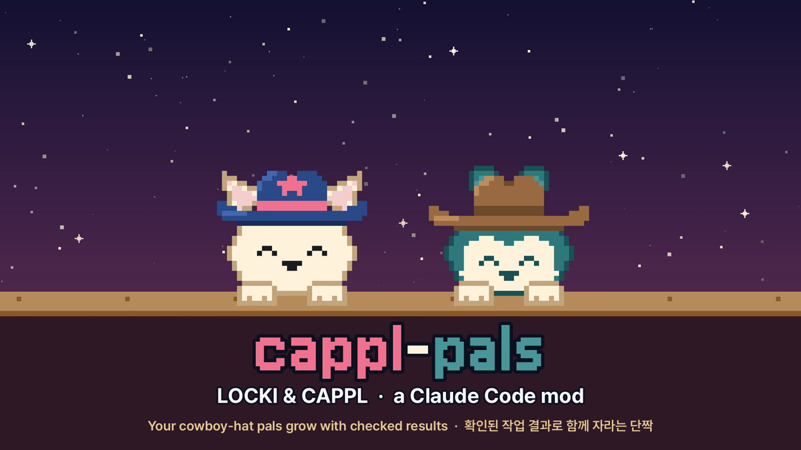

# cappl-pals

**LOCKI and CAPPL, the cowboy-hat pals of the [CAPPL](#characters) app, grow with your Claude Code work.** Pick one. They peek over your prompt, tap their paws while Claude works, and cheer when a test passes, a commit lands or a pull request merges. Results earn rep and gold. Rep raises your rank from Greenhorn to Legend of the West; gold buys hats, shades, banjos and backdrops.

[](docs/cappl-pals-demo.mp4)

Demo video (about a minute): [`docs/cappl-pals-demo.mp4`](docs/cappl-pals-demo.mp4)


[한국어 README](README.ko.md)

## Install

cappl-pals is a Claude Code mod (a plugin with a hooks module). It needs Claude Code 2.1.287 or later.

```
/plugin install cappl-pals --marketplace develinu/cappl-pals
```

Answer `y` to add the marketplace and keep the user scope. The pane opens in the session where you install it. For sessions that were already open, run `/reload-plugins`. To install from a shell, run `claude plugin install cappl-pals --marketplace develinu/cappl-pals`.

Updates: run `/plugin`, open **Marketplaces**, select `cappl-pals` and turn on **Enable auto-update**. Without auto-update, run `claude plugin update cappl-pals@cappl-pals` and then `/reload-plugins`.

## Use

| | |
|---|---|
| `/cappl` | Open or close the pane. It works mid-turn. A closed pane stays closed in later sessions. |
| `/cappl-pick` | Choose your partner. `/cappl-pick cappl` switches right away; `/cappl-pick` alone opens the picker. |
| `/cappl-status` | Level, rank, rep and gold in one line. |
| `/cappl-rules` | The reward table and how many of each you earned today. |
| `/cappl-sound` | Cycle the sound: normal → quiet → off. |

To use the pane's buttons, focus it with a click or `ctrl+x` then `Tab`. Then press `1`–`0` to buy an item or to put it on and take it off, `c` to switch characters, or `q` to close. On a wide fullscreen terminal (110 columns or more) the pane docks on the right. On other terminals it opens above the prompt. A low pane shows the small sprite with your stats beside it and a hint to scroll down to the shop.

Several sessions share one profile. Rep, gold, recent rewards, purchases and your choice of character show up in every open pane within about two seconds.

The language follows Claude Code's `language` setting (Korean or English). To pin it, open `/config` and change **cappl-pals › Language**.

## The pals

| | LOCKI | CAPPL |
|---|---|---|
| Who | Wants to be sheriff. Bright, bouncy, never without the pink star. | A drifter in a wide brown hat. Slow, steady, always humming a tune. |
| Sound | Square-wave chiptune, a harmonica, quick chirps, jingling spurs | Plucked banjo, a soft hum, hoof clops |
| Celebrates with | Twinkling pink and gold stars, ears perked | Music notes floating up, a tip of the hat |
| Wardrobe | Aviator shades, pink feather, harmonica, heart shades, lasso, gold sheriff star, desert noon, white ten-gallon hat, desert sunset, starry night hat | Round specs, wheat straw, tin cup of coffee, outlaw bandana, banjo, sparrow friend, campfire, black hat, starry night, golden banjo |

Each character keeps their own wardrobe; gold is shared. Every item has art at both sprite sizes ([sprite sheet](docs/cappl-pals-sheet.png)).

## What earns rewards

Rewards go to results a person can check, never to how much Claude did. Prompts, turns, tool calls, tokens and lines of code earn nothing.

| Reward | When | Rep | Gold |
|---|---|---|---|
| Bullseye | The first passing test after you edit files | 5 | $3 |
| Showdown won | A test fails, you fix it, it passes | 8 | $5 |
| Claim staked | A commit (+5 rep and $3 more if tests passed since the last one, +2 rep if it is small) | 3 | $2 |
| Gold strike | `gh pr merge` succeeds | 15 | $10 |
| Trail mapped | A plan approved before editing | 3 | $2 |
| Campfire rest | Back from a 20-minute-plus break after an hour of work | 2 | $4 |
| Saddled up | Your first prompt of the day | 0 | $10 |

If you earn many rewards of one kind in a day, each new one is worth half, then a fifth. There are no streaks and no penalties, and a day off costs nothing. A day starts at 05:00 on your computer's clock. Level 50 takes about 1,000 active hours at a steady pace. The numbers and their reasoning are in [docs/reward-design.md](docs/reward-design.md).

## Privacy

cappl-pals has no server and makes no network calls. It reads no files, and the validator's report (`claude plugin validate ./mod`) lists no `$.http` and no `$.fs`. It runs outside processes only to play sounds: `uname`, `wslpath`, `powershell.exe`, `paplay`, `pw-play` or `aplay`. It reads one setting, `language`. Progress stays in `~/.claude/plugins/store/cappl-pals_*.json` on your machine. There are no leaderboards.

## Tune the pace to your own history

The level curve was calibrated on 27 days (185 active hours) of one heavy user's Claude Code history. To see how fast it runs for you:

```sh
python3 -I tools/extract_events.py ~/.claude/projects .data/events.jsonl
bun tools/sim.ts .data/events.jsonl
```

No prompts or code are kept. For test, commit and merge commands only, the command and the start and end of its output go to `.data/`, which git ignores. To change the pace, change `LEVEL_BASE` in `mod/hooks/rules.ts`.

## Develop

```sh
claude --plugin-dir ./mod              # run without installing; edits reload on save
claude plugin validate ./mod
claude plugin test ./mod
npx -p typescript@5.9 tsc -p ./mod     # after one run with --plugin-dir lays the types
python3 tools/draw_art.py --png /tmp/draft.png   # redraw the pixel art (writes mod/hooks/characters/art.ts)
python3 tools/make_sfx.py              # resynthesize the sounds (needs numpy)
bun tools/preview.ts docs/cappl-pals-sheet.png
```

| Path | What |
|---|---|
| `mod/hooks/register.tsx` | Hooks, commands, the pane |
| `mod/hooks/rules.ts` | Rewards, levels, the shop |
| `mod/hooks/sprite.ts` | Frame composer: moods, items, sparkles |
| `mod/hooks/characters/` | Who the characters are (`index.ts`) and their pixels (`art.ts`, generated) |
| `mod/hooks/i18n.ts` | English and Korean |
| `mod/hooks/sound.ts` | Sound playback per platform |
| `tools/` | Art, sound, preview, history replay |

To add a character, see [docs/characters.md](docs/characters.md).

## Characters

LOCKI and CAPPL are characters of the CAPPL app, used here with permission.

## License

The code is under the [MIT License](LICENSE). The LOCKI and CAPPL characters and their art may be used as part of cappl-pals and its forks; any other use needs the CAPPL app's permission. See [ART-LICENSE.md](ART-LICENSE.md).
